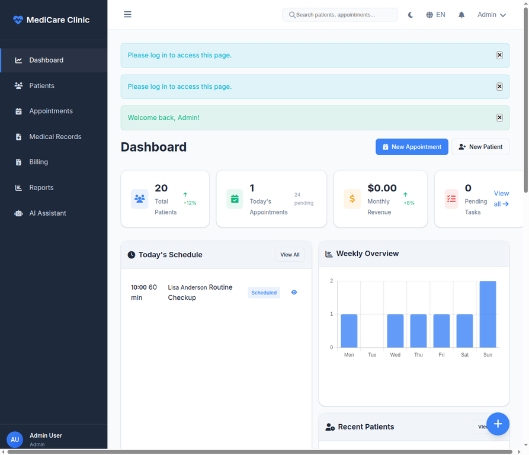
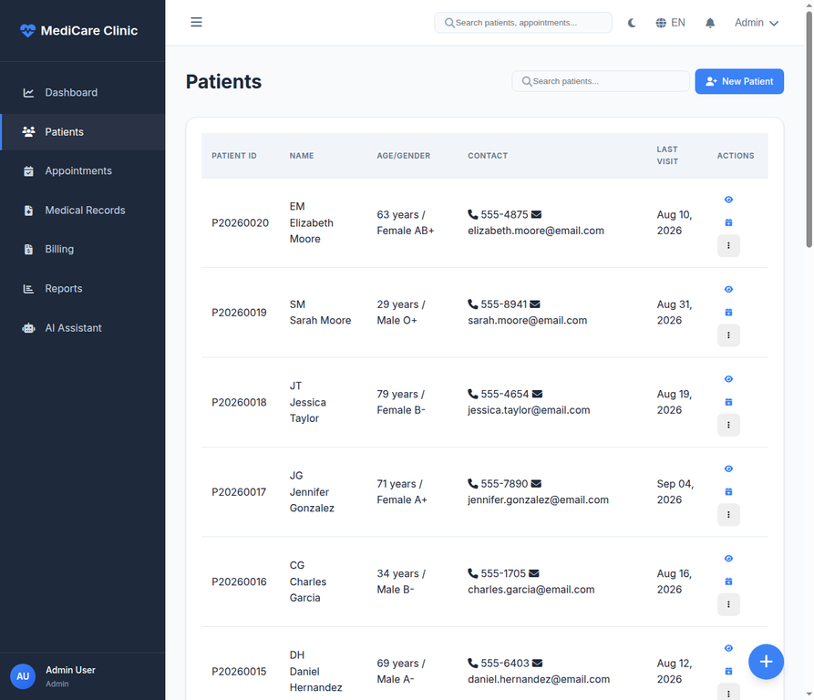

# 🏥 MediCare Clinic - Comprehensive Management Platform

**MediCare Clinic** is a professional-grade healthcare management solution designed to streamline clinic operations. Built with Flask and modern web technologies, it provides a centralized platform for patient records, appointment scheduling, billing, and AI-driven patient support.

---

## 🏗️ System Architecture

The platform follows a modular architecture, ensuring scalability, security, and a seamless user experience across different roles (Admin, Doctor, Receptionist).


### **Key Technical Features**
- **Role-Based Access Control (RBAC)**: Secure access management for Admins, Doctors, and Staff.
- **Smart Scheduling**: Interactive calendar with drag-and-drop support and automated conflict detection.
- **Electronic Health Records (EHR)**: Comprehensive patient profiles, medical history, SOAP notes, and ICD-10 integration.
- **Financial Suite**: Automated invoicing, payment tracking, and multi-format financial reporting.
- **AI Chatbot Integration**: 24/7 assistant for symptom checking, FAQs, and appointment booking.
- **Multi-language & Theme**: Full support for English/Arabic and Light/Dark modes.

---

## 📸 Platform Preview

### **Professional Landing Page**
Modern and responsive interface to introduce clinic services and features.


### **Administrative Dashboard**
Real-time analytics, revenue trends, and a quick overview of today's schedule.


### **Patient Management**
Searchable database with detailed medical history and vital signs tracking.


---

## 🚀 Core Modules

### 🩺 Medical Management
- **Digital Prescriptions**: Fast and accurate prescription writing with a built-in medicine database.
- **Lab Test Management**: Order tests and track results directly within the patient profile.
- **Vital Signs Monitoring**: Track and visualize patient health trends over time.

### 📅 Operational Excellence
- **Interactive Calendar**: Manage appointments across multiple doctors with ease.
- **Waiting Room Queue**: Real-time tracking of patient status in the clinic.
- **Audit Logging**: Comprehensive logs for every action taken within the system for HIPAA/GDPR compliance.

### 💰 Financial & Reporting
- **Invoice Generation**: Professional invoices with PDF export capabilities.
- **Revenue Analytics**: Detailed charts and reports on clinic performance.
- **Insurance Handling**: Streamlined billing for insured patients.

---

## 🛠️ Technology Stack

- **Backend**: Flask 2.3+, SQLAlchemy ORM, Flask-Login, Flask-WTF
- **Database**: SQLite (Production-ready for PostgreSQL/MySQL)
- **Frontend**: Vanilla JavaScript (ES6+), Jinja2, CSS Grid/Flexbox
- **Charts & Calendar**: Chart.js, FullCalendar.js
- **Security**: Werkzeug Hashing, CSRF Protection, Input Sanitization

---

## 🚦 Getting Started

### **Prerequisites**
- Python 3.8+
- pip (Python package manager)

### **Installation**
1. **Clone the repository**:
   ```bash
   git clone https://github.com/amkkoussay/clinique.git
   cd clinique
   ```
2. **Install dependencies**:
   ```bash
   pip install -r requirements.txt
   ```
3. **Initialize the database**:
   ```bash
   python init_db.py
   python seed.py
   ```
4. **Run the application**:
   ```bash
   python app.py
   ```
   Access the platform at `http://localhost:5000`.

### **Default Credentials**
- **Admin**: `admin@clinic.com` / `admin123`
- **Doctor**: `dr.smith@clinic.com` / `doctor123`

---

## 📝 License
This project is licensed under the MIT License.
