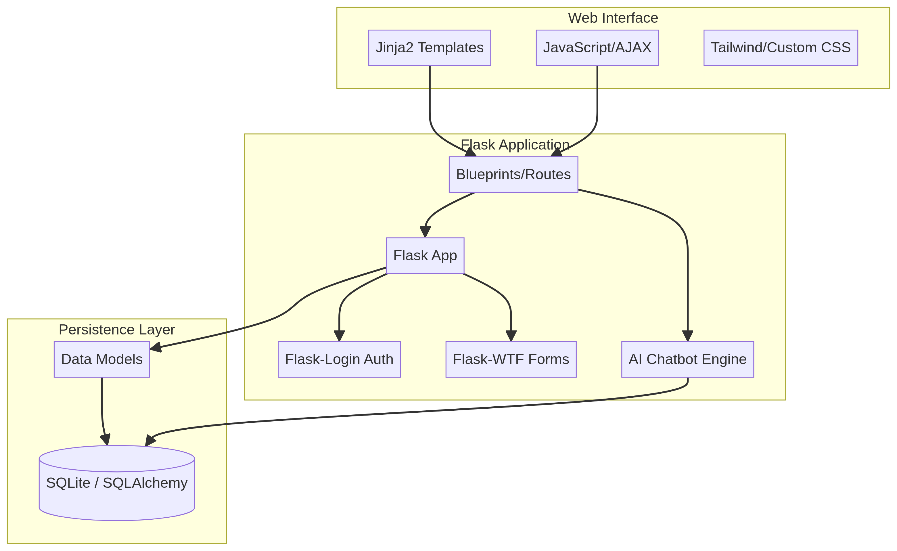

# Clinique — Clinic Management Prototype

**Clinique** is a portfolio-scale clinic management prototype built with Flask, SQLAlchemy, and vanilla JavaScript. It explores how patient records, appointments, medical notes, billing, and role-based workflows can be organised in a small health-information system.

> **Project status:** Prototype / educational project. Clinique is not a certified medical device, production healthcare service, or compliance-certified system. Do not use it with real patient information.

---

## What the project demonstrates

Clinique focuses on practical health-information workflows and a modular Flask structure. The current codebase includes authentication flows, role-aware navigation, patient and appointment management, medical records, prescriptions, billing screens, reports, and an audit-trail concept for local development and testing.

The project is intended to demonstrate software and systems-engineering thinking: separating routes and models, validating user input, protecting forms with CSRF, hashing passwords, and making the workflow explicit for different roles such as administrators, doctors, and reception staff.

## Core modules

### Clinical workflow

- Patient profiles and searchable patient records.
- Appointment scheduling and status tracking.
- Medical notes, prescriptions, and medicine lookup.
- ICD-10-oriented fields and health-data structures where represented in the current models and templates.

### Operations and reporting

- Dashboard summaries and charts.
- Billing and invoice screens.
- Printable reports and CSV export paths.
- Local audit-trail structures for development review.

### Interface

- Responsive Jinja templates with vanilla JavaScript.
- Light and dark theme support.
- English and Arabic interface foundations.
- Input validation, CSRF protection, password hashing, and basic file-upload safeguards.

These features are presented as implementation experiments in a portfolio project. They should not be interpreted as a claim of clinical validation, security certification, or HIPAA/GDPR compliance.

## Architecture

The application uses a modular Flask structure with SQLAlchemy models, blueprints for route groups, Jinja templates, and static assets. SQLite is suitable for local exploration; a production deployment would require a security review, a managed database, secret management, access controls, monitoring, backups, and a formal regulatory and privacy assessment.



## Technology stack

- **Backend:** Flask, SQLAlchemy, Flask-Login, Flask-WTF.
- **Database:** SQLite for local development; PostgreSQL or MySQL would require additional deployment work.
- **Frontend:** Jinja2, vanilla JavaScript, CSS Grid, and Flexbox.
- **Charts and calendar:** Chart.js and FullCalendar.js.
- **Security foundations:** Werkzeug password hashing, CSRF protection, input validation, and basic upload checks.

## Local setup

### Prerequisites

- Python 3.8 or newer.
- `pip`.

### Installation

```bash
git clone https://github.com/amkkoussay/clinique.git
cd clinique
python -m venv .venv
source .venv/bin/activate  # Windows: .venv\Scripts\activate
pip install -r requirements.txt
python init_db.py
python seed.py
python app.py
```

Open `http://localhost:5000` after starting the local server. The initialization and seed scripts are intended for local demo data only. Review and replace any development credentials before sharing a running instance, and never commit secrets, databases, logs, or real health data.

## Data and safety boundary

This repository intentionally does not include a database file, runtime logs, Python bytecode, uploaded files, or other local artifacts. The `.gitignore` rules prevent those files from being added accidentally.

Clinique is a software prototype, not a substitute for a clinical information-system assessment. Before any real-world use, the application would need threat modelling, independent security testing, privacy and data-governance review, clinical safety review, audit controls, access-management hardening, secure deployment, and jurisdiction-specific legal and regulatory analysis.

## License

This project is licensed under the MIT License. See [LICENSE](./LICENSE).
