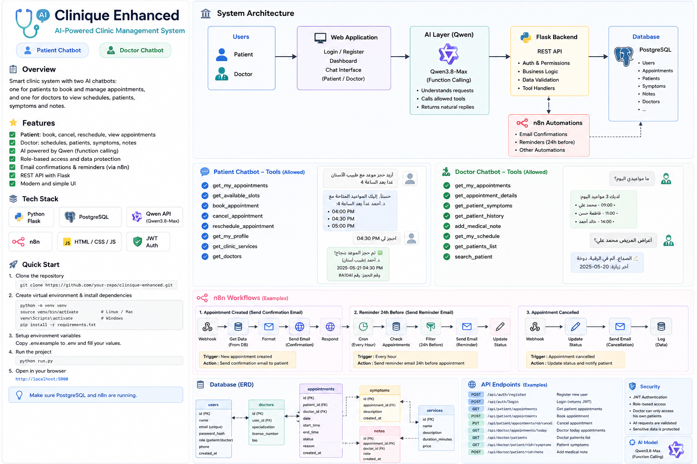
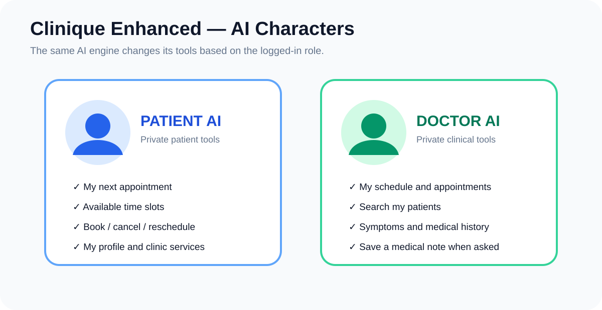
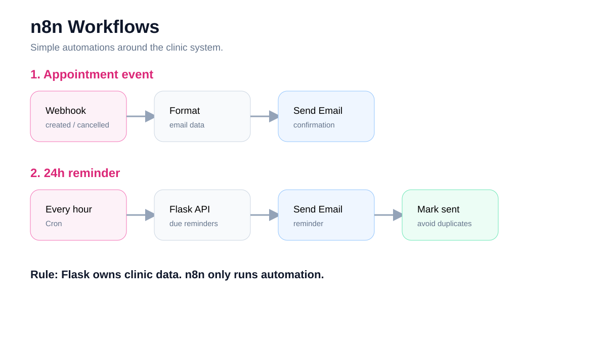
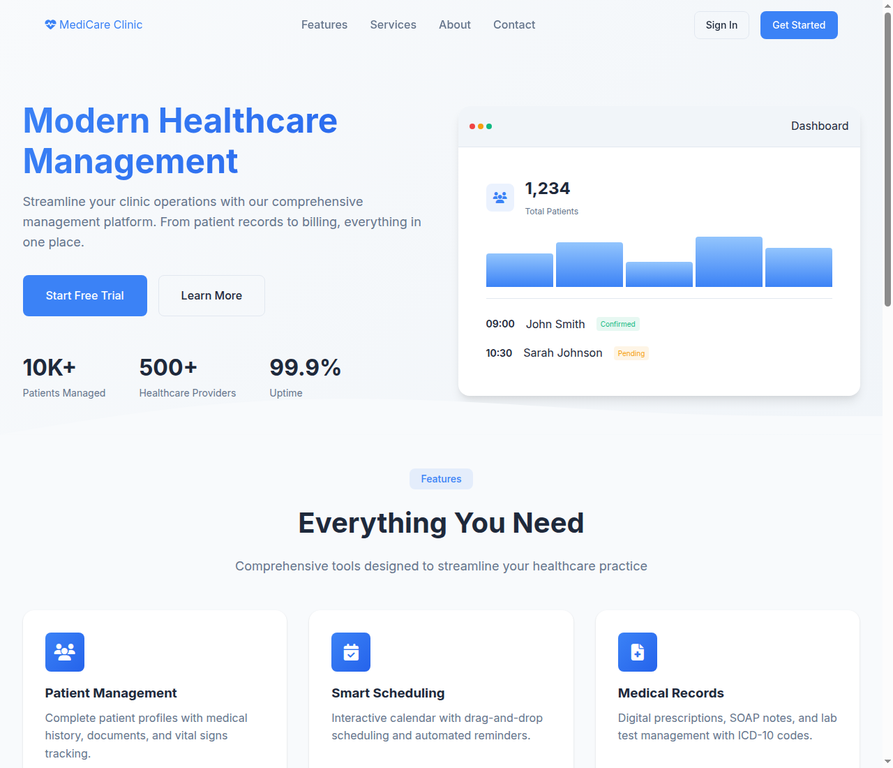
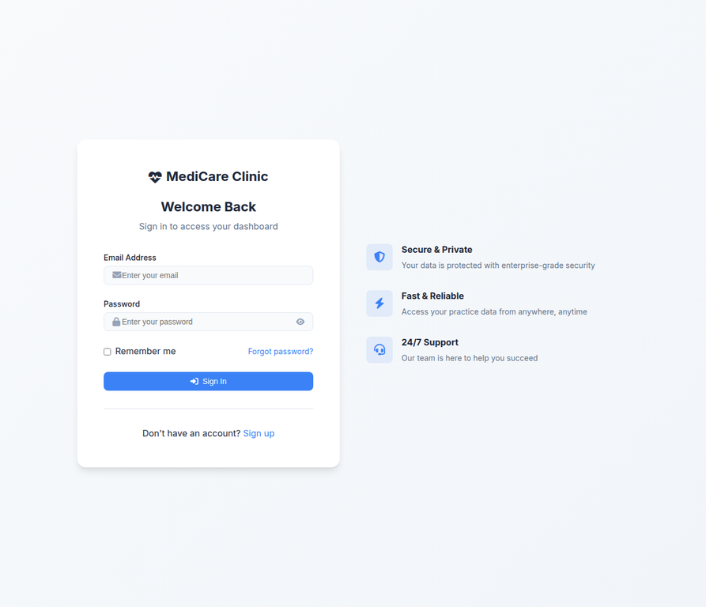
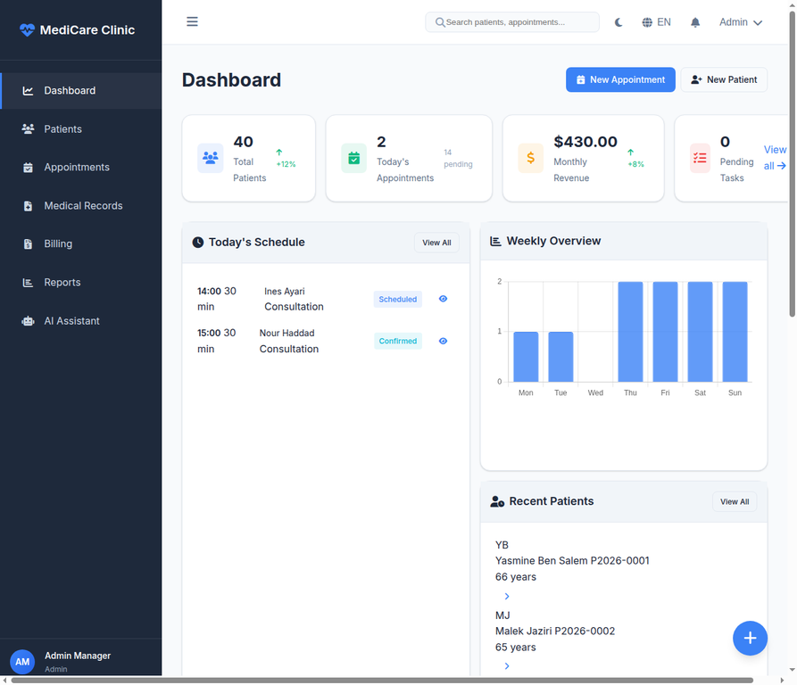
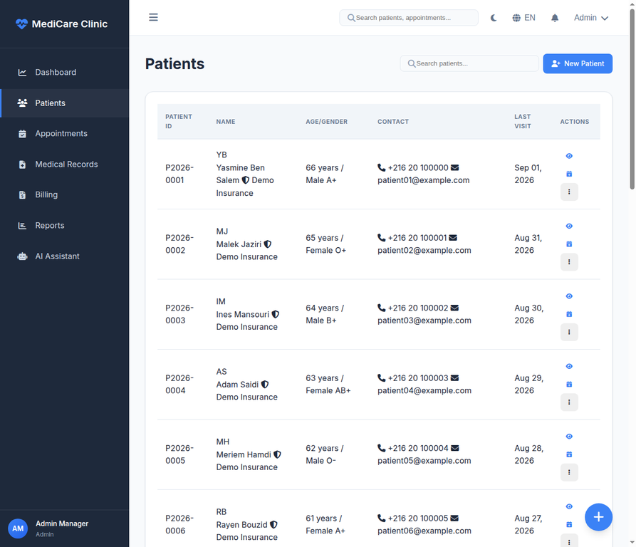
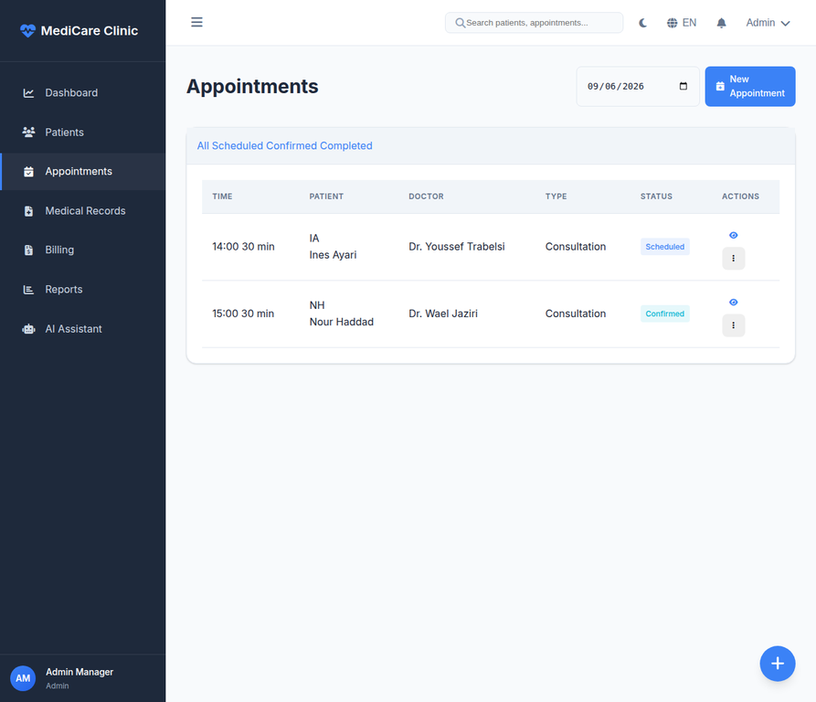
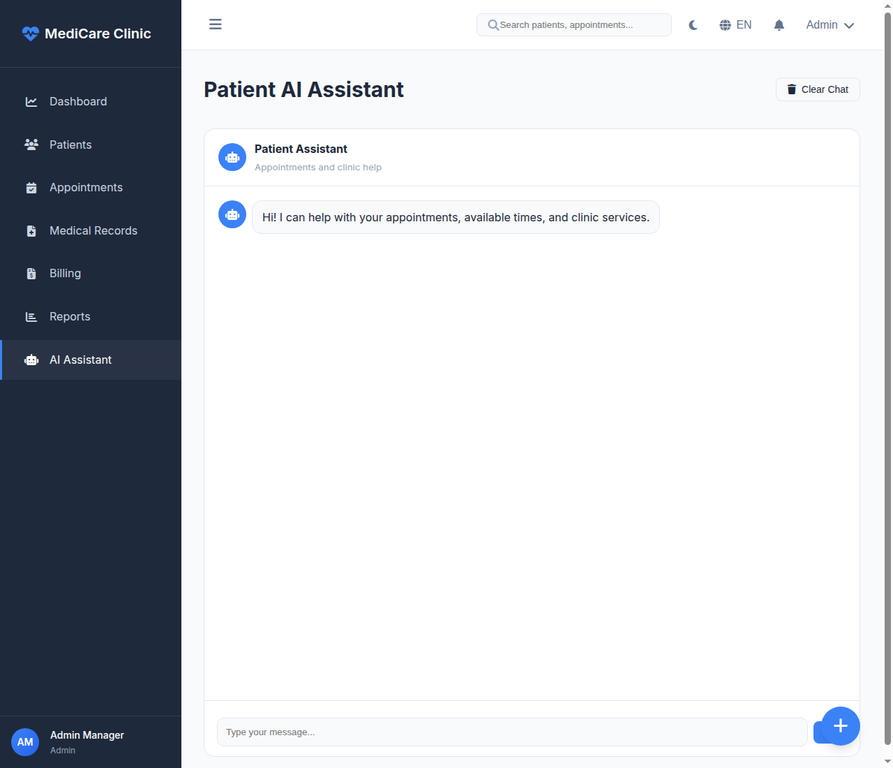

# Clinique Enhanced



Clinique Enhanced is a clinic web app. It helps a clinic manage patients, doctors, visits, medical notes, bills, and email messages.

The app has two chat helpers. The patient helper works with visits and clinic services. The doctor helper works with schedules and patient data that the doctor is allowed to see.

> This app is for local tests and demo work. It is not a doctor and it must not make a medical choice.

## What the app can do

| Area | What it does |
| --- | --- |
| Patients | Save patient details, visits, files, and vital signs. |
| Visits | Book, change, cancel, and view visits. |
| Medical data | Save notes, lab tests, medicines, and prescriptions. |
| Bills | Create bills, record payments, and view reports. |
| Patient chat | Show visits, free times, doctors, and services. It can book, cancel, or change a visit. |
| Doctor chat | Show the doctor schedule, patients, symptoms, history, vital signs, prescriptions, and lab results. It can save a note when the doctor asks. |
| Email jobs | Send booking messages and 24 hour reminders with n8n. |

## Images in `docs`

The project has three main images. They are kept in the `docs` folder.

### Full app view

This image shows the main parts of the app. It shows the users, web pages, AI chat, Flask server, data store, n8n email jobs, chat actions, tables, API examples, and safety notes.


### Patient and doctor chat

This image shows the two chat helpers. The patient helper can work with the patient's own visits and clinic services. The doctor helper can work with the doctor's schedule and allowed patient data.



### Email jobs

This image shows two simple email jobs. One job sends a message when a visit is made or canceled. The other job checks each hour for visits that are close to 24 hours away.



## Live screenshots

These images were taken from the app while it was running on a local computer.

### Home page

The home page shows the main message, the main actions, and the clinic features.



### Sign in page

The sign in page lets a user enter an email and a password.



### Main dashboard

The dashboard shows patient count, today's visits, monthly income, the weekly chart, recent patients, and quick actions.



### Patient list

The patient page shows patient IDs, names, age, contact data, and last visit dates.



### Visit list

The visit page shows the date, time, patient, doctor, visit type, and visit status.



### AI assistant

The AI page has a chat box. A patient can ask for help with visits, free times, and clinic services.



## Simple app flow

A user opens the web page and signs in. The user then sees pages that match the user's role. The chat helper also checks the role before it reads or changes clinic data.

```text
User
  |
  v
Web page
  |
  v
Flask server
  |
  +--> AI chat helper
  |
  +--> Clinic data
  |
  +--> Email jobs
```

The chat helper does not read the data store by itself. The server checks each action first.

## Safe visit booking

Before a visit is saved, the app checks that the time is still free. It also uses a unique visit key. This helps stop two users from taking the same time.

## Email jobs with n8n

The two ready files are:

```text
n8n/01_appointment_events.json
n8n/02_24h_reminders.json
```

The app owns the clinic data. n8n only runs the email jobs.

Use these values in the n8n setup when needed:

```env
CLINIC_BASE_URL=http://127.0.0.1:5000
N8N_API_KEY=the-same-secret-used-by-Flask
MAIL_DEFAULT_SENDER=noreply@example.com
```

You also need one SMTP email login in n8n. If n8n runs in Docker and the app runs on the host, use an address that the Docker service can reach, such as `http://host.docker.internal:5000`.

## Local setup

You need Python 3.10 or newer.

Create a local Python space:

```bash
python -m venv venv
```

On Linux or macOS, turn it on with:

```bash
source venv/bin/activate
```

On Windows, turn it on with:

```bat
venv\Scripts\activate
```

Install the packages:

```bash
pip install -r requirements.txt
```

Make a local environment file:

```bash
cp .env.example .env
```

Open `.env` and add the values you need. Keep this file private. The `.env` file must not be shared.

Start the app:

```bash
python run.py
```

Open this address in a browser:

```text
http://127.0.0.1:5000
```

## Safe environment template

The shared template has empty values only. It is safe to share as `.env.example`:

```env
QWEN_API_KEY=
DATABASE_URL=
SECRET_KEY=
MAIL_USERNAME=
MAIL_PASSWORD=
N8N_API_KEY=
```

Do not put real keys or passwords in this file.

## Demo data

The project has a made up demo data set for local tests. It has 6 doctors, 8 patient login accounts, 40 patients, 38 visits, medical notes, vital signs, lab tests, prescriptions, bills, payments, and messages. All names, emails, phone numbers, and medical data are fake.

To make the demo data again, run:

```bash
python seed_demo_full.py
```

All demo accounts use this password:

```text
Demo123!
```

Example accounts:

| Role | Email |
| --- | --- |
| Patient | `patient01@example.com` |
| Doctor | `dr.amina.benali@clinique-demo.example` |
| Admin | `admin@clinique-demo.example` |

Use these accounts for local tests only.

> **WARNING: seeded accounts are demo-only.** Change or remove them before
> any real deployment, and never use them with real patient data. The demo
> password can be overridden with the `CLINIQUE_DEMO_PASSWORD` environment
> variable; `seed.py` likewise reads `CLINIQUE_SEED_ADMIN_PASSWORD` and
> `CLINIQUE_SEED_DOCTOR_PASSWORD` (its defaults are DEMO-ONLY and are
> labelled as such when printed).

## Project folders

```text
clinique/
├── routes/                 Page and data actions
├── templates/              Web page files
├── static/                 Style and browser files
├── n8n/                    Email job files
├── docs/                   Main images and live screenshots
├── models.py               Data shapes
├── config.py               App settings
├── .env.example            Safe empty settings file
└── README.md               This guide
```

## Files that must stay private

Do not share or upload these files or folders:

```text
.env
clinic.db
venv/
__pycache__/
*.pyc
```

The `.gitignore` file already ignores these common private files. The local demo data file is for local tests only.

## License and safety

Keep patient data, passwords, and keys private. Use fake data for tests. Do not use this app as an automatic diagnosis system.
